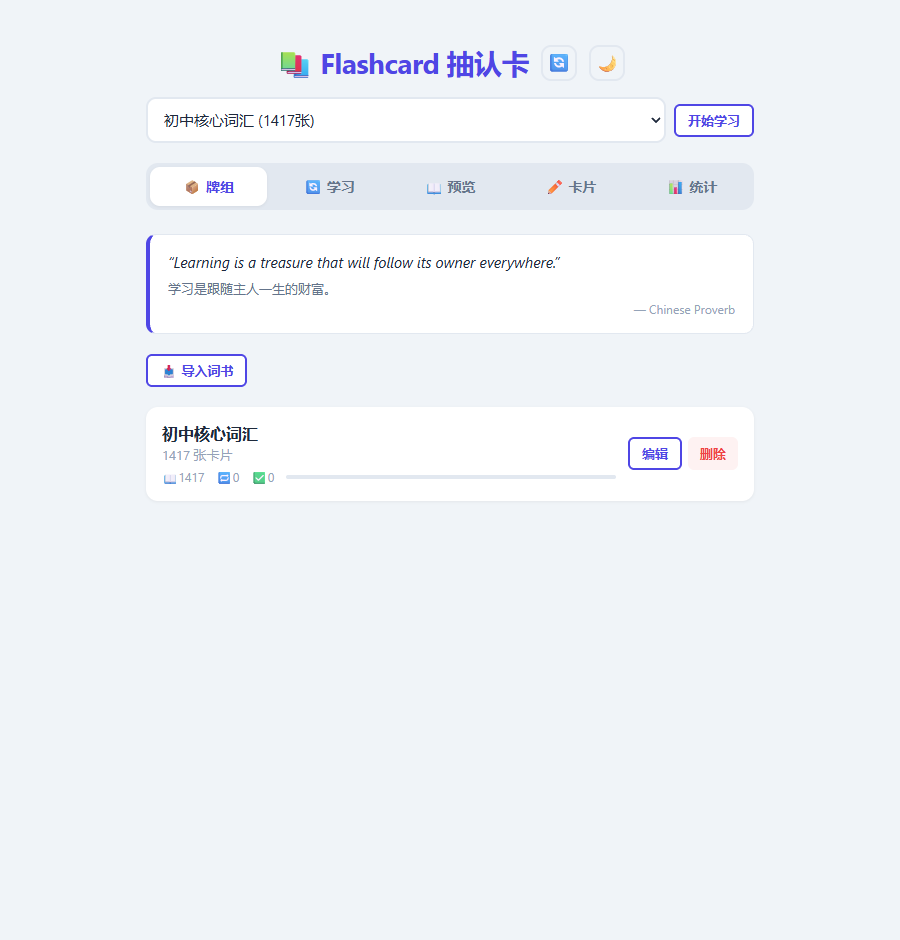
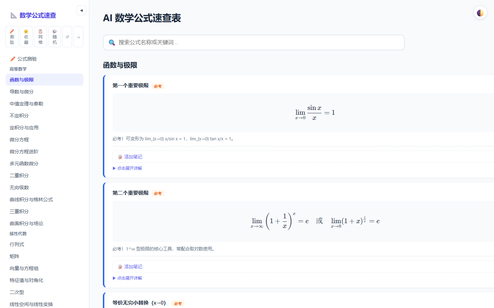
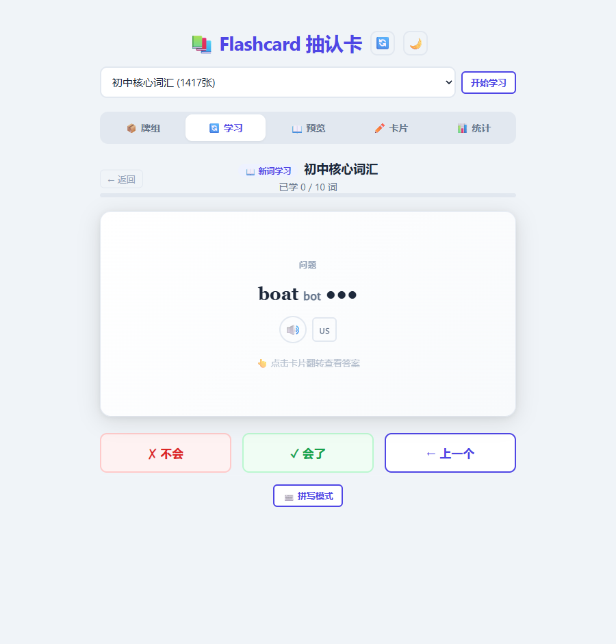
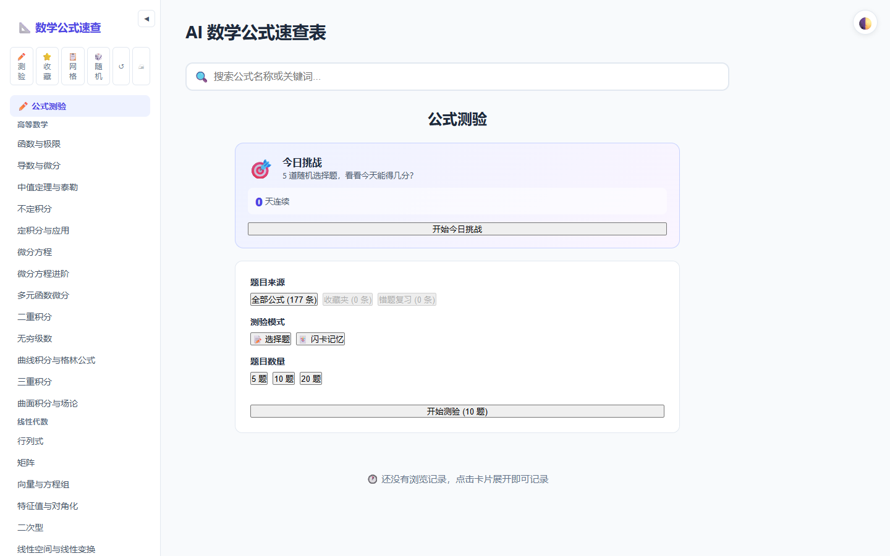

# Study Tools

[](https://github.com/lx825-AI/study-tools/actions/workflows/ci.yml)
[](https://github.com/lx825-AI/study-tools/releases)

两个学习工具，同一套代码同时提供 **网页（PWA）/ Windows 桌面应用 / Android 应用**：

- **[English-web](web/English-web/)** — 基于艾宾浩斯遗忘曲线的英语词汇闪卡，内置 20 套词书（乱序 + 正序，约 28K 词，100% 音标）
- **[math-web](web/math-web/)** — 大学数学公式速查（React + KaTeX），覆盖 5 学科 34 章节 177 条公式

## 应用下载

发布包由 GitHub Actions 在打 tag 时自动构建，统一放在 [Releases](releases)：

| 平台 | 英语闪卡 | 数学公式 |
|------|----------|----------|
| Windows | `Flashcard-<版本>-win-x64-setup.exe` | `MathReference-<版本>-win-x64-setup.exe` |
| Android | `flashcard-<版本>-android.apk` | `math-reference-<版本>-android.apk` |
| 网页 | https://lx825-ai.github.io/study-tools/english/ | https://lx825-ai.github.io/study-tools/math/ |

- 桌面端是 Electron 安装包（NSIS），安装后离线可用。
- Android 包由仓库**固定密钥**签名（`study-tools`），同一密钥签出的新版本可直接覆盖安装（保留应用内数据）；首次安装需在系统里允许「未知来源应用」。上架应用商店需另走商店要求的签名与打包流程。
- iOS 暂不提供安装包，用 Safari 打开网页版「添加到主屏幕」即可获得 App 体验。

## 更新

- **桌面端**：v1.1.0 起内置自动更新——启动后静默检查 GitHub Releases，下载完成弹窗询问是否重启，重启即生效。v1.0.0 没有这套机制，需要手动下载一次 v1.1.0。
- **网页版**：Service Worker 自动换新缓存，刷新即是新版本。
- **Android**：没有自动更新，新版本需手动下载安装。签名密钥固定，因此可以直接覆盖升级、数据保留；若在更早的调试签名版本上升级，会提示「应用未安装 / 签名不一致」，先卸载旧版再装（请先用内置导出功能备份数据）。

## 界面预览

| 英语闪卡 | 数学公式 |
|------|------|
|  |  |
|  |  |
|  | |

## 安装与首次运行

**Windows（`.exe`）**

1. 下载 `*-win-x64-setup.exe`，双击运行。
2. 若出现蓝色「Windows 已保护你的电脑」提示，这是 SmartScreen 对**未签名**应用的默认拦截（本项目没有代码签名证书）。点 **更多信息 → 仍要运行**。
3. 如果安装包是从浏览器下载后放了一段时间才运行，可能被标记为「来自其他计算机」：右键文件 → 属性 → 底部勾选 **解除锁定** → 确定。
4. 安装完成后从开始菜单启动；数据保存在 `%APPDATA%/Flashcard 抽认卡`、`%APPDATA%/数学公式速查`（Electron 的用户数据目录）。
5. 卸载：设置 → 应用 → 已安装的应用 → 选择对应条目 → 卸载。

**Android（`.apk`）**

1. 下载 `*-android.apk` 并点击安装。
2. 系统会提示「禁止安装未知应用」——在弹窗里选择 **设置** 并允许该来源（浏览器或文件管理器）安装应用。
3. 安装包使用仓库固定密钥签名，可以正常侧载与覆盖升级；上架应用商店需另配商店签名。
4. 卸载：长按图标 → 应用信息 → 卸载。

> 首次启动如果是全新安装，应用会引导你选择词书（英语）或直接进入公式库（数学）；不需要联网。

## 快速开始

```bash
# 网页开发与测试（根目录脚本）
npm run test:all      # 两端测试（English-web + math-web）
npm run build:all     # 两端构建产物

# 或单独操作
cd web/English-web && npm install && npm run build && npm test
cd web/math-web       && npm install && npm run build && npm test
```

## 打包 App

```bash
# Windows 安装包（需本机可下载 Electron，产物写入 dist-apps/）
npm run package:desktop:english
npm run package:desktop:math

# Android APK（需 JDK 21 + Android SDK；本机没有工具链时交给 CI）
npm run package:android:english
npm run package:android:math
```

发布流程：`git tag v1.0.0 && git push origin v1.0.0` → `.github/workflows/release.yml` 在 Windows/Ubuntu runner 上构建 4 个产物并汇总成一个 Release。桌面端还会额外产出 `latest.yml` 与 `.blockmap`，供自动更新使用。

### Android 固定签名（让新版本能覆盖安装）

CI 用 Secrets 里的固定 keystore 签名（构建日志的「校验 APK 签名」步骤会断言证书 DN 为 `CN=Study Tools`，配错会直接失败）。未配置 Secrets 时退回构建机临时调试签名，此时两次构建签名不同、无法覆盖安装。配置方式：

```bash
# 1. 生成 keystore（有效期 10000 天，别名 study-tools）
keytool -genkeypair -v -keystore release.keystore -alias study-tools \
  -keyalg RSA -keysize 2048 -validity 10000

# 2. 转成 base64 供 Secrets 使用（Windows 用 PowerShell：
#    [Convert]::ToBase64String([IO.File]::ReadAllBytes("release.keystore"))）
base64 -w0 release.keystore
```

在仓库 Settings → Secrets and variables → Actions 里添加 4 个 Secret：

| Secret | 内容 |
|--------|------|
| `ANDROID_KEYSTORE_BASE64` | keystore 文件的 base64 |
| `ANDROID_KEYSTORE_PASSWORD` | keystore 密码 |
| `ANDROID_KEY_ALIAS` | 别名（如 `study-tools`） |
| `ANDROID_KEY_PASSWORD` | 密钥密码 |

四个 Secret 齐全时，CI 自动构建 `assembleRelease` 签名包；一个都没配则继续用调试签名。**keystore 一旦丢失就无法再发布可覆盖升级的版本，请离线备份。**

## 功能特性

### English-web 英语闪卡

| 功能 | 说明 |
|------|------|
| 艾宾浩斯调度 | 8 阶段（0/1/2/4/7/15/30/90 天）单轨间隔重复，EF 自适应间隔 |
| 词书 | 20 套（初/高中、四级、六级、考研 × 大纲/核心 × 乱序/正序），约 28K 词 |
| 学习模式 | 深度（动态队列重插）、今日复习（紧急度排序）、错题强化、快速浏览、拼写（纯练习） |
| 发音 | 有道音频，英/美音切换，失败自动重试 |
| 数据管理 | 牌组导入、卡片列表与批量删除、统计仪表盘（热力图/遗忘曲线）、JSON 导出导入同步 |
| 离线 | PWA Service Worker 缓存，桌面端与 Android 端为本地文件加载 |

### math-web 数学公式

| 功能 | 说明 |
|------|------|
| 公式速查 | 5 大学科 34 章节 177 条公式，KaTeX 渲染 |
| 搜索筛选 | 全文搜索、学科/难度筛选、搜索历史 |
| 收藏与最近 | 收藏夹、最近浏览记录 |
| 公式测验 | 选择题/闪卡模式、每日挑战、错题本 |
| 学习进度 | 章节级别已学/未学追踪 |
| 主题 | 自动/暗色/亮色三模式 |
| 离线 | Service Worker 预缓存、打印支持 |

## 项目结构

```
web/English-web/   -- 英语闪卡 PWA + 词书源数据（wordbooks-src/）
web/math-web/         -- 数学公式 PWA
apps/
  desktop-english/     -- Electron 壳（加载 English-web dist）
  desktop-math/        -- Electron 壳（加载 math-web dist）
  mobile-english/      -- Capacitor 壳（Android，加载 English-web dist）
  mobile-math/         -- Capacitor 壳（Android，加载 math-web dist）
.github/workflows/     -- ci.yml（测试+构建）、deploy.yml（Pages）、release.yml（App 发布）
```

## 技术栈

| | English-web | math-web | apps/ 桌面 | apps/ 移动 |
|------|------|------|------|------|
| 框架 | 纯 JavaScript (ES2017+) | React 18 + TypeScript | Electron 33 | Capacitor 7 |
| 构建 | esbuild | Vite 6 | electron-builder | Gradle + Android SDK |
| 公式渲染 | — | KaTeX | — | — |
| 测试 | Vitest（343 用例） | Vitest（48 用例） | — | — |
| 部署 | GitHub Pages | GitHub Pages | GitHub Releases | GitHub Releases |

## 文档

- 根目录 [CLAUDE.md](CLAUDE.md)：仓库级约定、命令、架构约束
- [web/English-web/CLAUDE.md](web/English-web/CLAUDE.md)：英语闪卡的学习算法、词书系统与同步协议
- [web/math-web/CLAUDE.md](web/math-web/CLAUDE.md)：数学公式应用的结构与约定

## 许可证与数据来源

- 本仓库代码以 [MIT License](LICENSE) 发布，Copyright © 2026 lx825-AI。
- 英语词书数据来自 [KyleBing/english-vocabulary](https://github.com/KyleBing/english-vocabulary)（MIT），经脚本整理为 `web/English-web/wordbooks-src/` 下的 20 套 JSON。
- 英语发音使用有道的公开音频接口（`dictvoice`），仅用于个人学习场景，不保证长期可用。
- 数学公式内容为教学整理，渲染依赖 [KaTeX](https://katex.org/)（MIT）。
